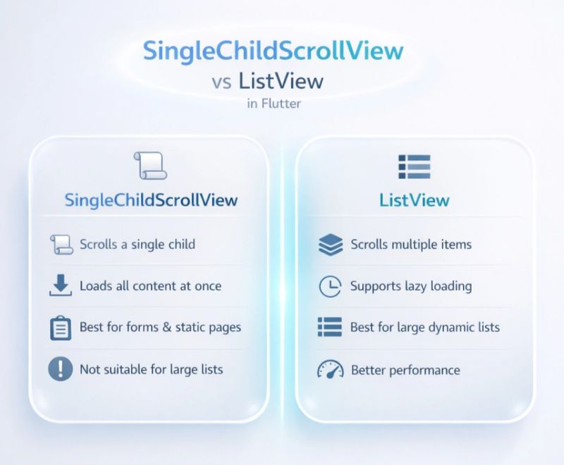

# myportofolio_mobile

A new Flutter project.

## Getting Started

This project is a starting point for a Flutter application.

A few resources to get you started if this is your first Flutter project:

- [Learn Flutter](https://docs.flutter.dev/get-started/learn-flutter)
- [Write your first Flutter app](https://docs.flutter.dev/get-started/codelab)
- [Flutter learning resources](https://docs.flutter.dev/reference/learning-resources)

For help getting started with Flutter development, view the
[online documentation](https://docs.flutter.dev/), which offers tutorials,
samples, guidance on mobile development, and a full API reference.

---

### Tugas 7

1. Widget-tree adalah suatu struktur hierarki yang membentuk elemen-elemen ui di tampilan apps. Parents dalam widget adalah elemen yang membungkus dan child adalah elemen yang dibungkus (seperti div di html). Cara kerjanya adalah elemen yang ada di parent akan diwariskan ke elemen child. Contoh penerapannya ada pada pembentukkan grid dimana row dan collumn diatur oleh parent lalu isi elemen yang mana adalah content dari grid tersebut adalah childnya.

2.

- MaterialApp->widget root yang menjadi dasar ui apps (contoh penggunaannya adalah set color pallete global).
- scaffold->layout dasar dari apps
  -Appbar->Toolbar/Navbar
- Myapp->Widget utama yang menginisialisasi konfigurasi MaterialApp dan mengarahkan tampilan awal ke MyHomePage.
- MyHomePage->widget yang mengatur ui utama di halaman menu portofolio.
- InfoCard-> reuseable widget yang digunakan di project ini untuk membuat card nama,NPM,kelas.
- ItemCard-> reusable widget yang saat ini digunakan untuk membuat card di menu utama yang berisi konten yang ketika diclick memunculkan SnackBar
- Column & Row->menyusun posisi widget secara vertikal (column) dan horizontal (row).
- Container & SizedBox->mengatur dimensi lebar dan jarak dalam pada kartu, sedangkan SizedBox memberi jarak spasi kosong antar-elemen.
- Card & Material->Membuat panel kartu dengan efek bayangan pada InfoCard, sedangkan Material membentuk permukaan tombol berwarna dan sudut membulat pada ItemCard.
- InfoCard->Reusable widget untuk menampilkan kartu informasi identitas (NPM, Name, Class).
- Text & Icon->Text menampilkan tulisan/label, sedangkan Icon menampilkan ikon vektor bawaan Flutter.
- GridView.count->Menyusun daftar kartu menu dalam tata letak kisi (grid) berjumlah 3 kolom.

3. MaterialApp adalah material bawaan fliutter dimana widget ini mengatur tampilan global seperti color pallete, text font, navigasi main, dan format lokal lainnya pada aplikasi yang sedang dibuat dan inilah yang menjadi alasan widget ini menjadi root widget.

4. Stateless widget bisa dibilang sebagai widget yang menampilkan data statis atau tampilan yang tidak akan berubah-ubah seperti. Misalnya pada program ini adalah nama, npm, kelas yang mana atribut tersebut bersifat statis yang dibuat dengan syntax static final. Sementara itu, statefull adalah widget yang menampilkan data dinamis yang bisa berubah-ubah berdasarkan variabel/atribut state yang dibuat. Contoh dari statefull widget adalah tampilan pada saat setup aplikasi flutter yaitu widget yang berisi angka counter, ketika tombol counter diclick, angka yang ada pada widget tersebut berubah. Jadi, gunakan stateless saat ingin menampilkan data statis yang hanya bisa diubah dengan mengganti atribut (di class atau di parent) dan gunakan statefull ketika ingin menampilkan data dinamis (tidak hanya counter, bisa juga untuk menampilkan animasi, tampilan dinamis, atau tampilan yang dapat berubah-ubah lainnya).

5. BuildContext digunakan untuk menginisialisasi refrensi ke widget tree. Hal ini penting karena flutter menggunanakn widget tree untuk membangun hierarki widget. Salah satu cara penggunaanya adalah ketika kita mau mengakses suatu atribut parent ketika sedang membuat widget yang berada di child, use context adalah jalur untuk mengaksesnya. Contohnya :
   `Theme.of(context).colorScheme.primary,`
   disini widget mengambil atribut colorscheme.primary dari parent dengan (context) nya.
   Sumber: "https://medium.com/@dihsar/understanding-flutter-buildcontext-a-guide-for-developers-367579309f3a"

6. Hot reload itu seperti refresh pada browser, aplikasi mereload tampilan di aplikasi (menjalankan ulang build tanpa mematikan aplikasi) merender ulang widget tanpa mereset state. Sementara itu, hot restart adalah proses merestart ulang aplikasi layaknya me-run ulang program karena pada hot reload, state akan dimuat ualng (kembali ke initial state). kIta harus menggunakan Hot restart ketika kita membuat perubahan pada bagian state, merubah jenis state (misal dari statefull ke stateless), mengubah kode di dalam main. Untuk full restart kita harus menggunakannya ketika menggunakan atribut dari source eksternal yang mana mengharuskan project untuk direfresh.

---

### AI Disclosure

AI yang digunakan : Gemini

1. Saya menggunakan AI untuk mengetahui cara menggunakan hex code color untuk mengubah warna di widget.
2. Saya menggunakan AI untuk membantu mengidentifikasi state yang saya tidak ketahui, karena yang saya ketahui hanyalah materialAPP dan MyApp di main, dan stateless widget di menu.
3. Untuk pengertian stateless dan statefull saya menggunakan refrensi apa yang disampaikan di kelas
4. Untuk perbedaan hot reload, hot restart, dan full restart saya meminta pengertian nya ke AI dan melihat refrensi di website flutter. Meskipun begitu, ketiga metode tersebut sudah pernah dipakai ketika saya mengerjakan tugas ini.

---

### Tugas 8

1. -Navigator.push()-> Method push() menambahkan suatu route ke dalam stack route yang dikelola oleh Navigator. Jadi ketika suatu route sedang dibuka pengguna, lalu pengguna mentrigger suatu event yang menyebabkan navigator.push(), maka route pengguna tersebut akan tertimpa oleh route baru berdasarkan route yang dituju navigator. Konsepnya adalah push kedalam stack yang mana posisi pengguna akan selalu berada di top stack.
   -pushReplacement()-> Mirip seperti push() biasa, tetapi pushReplacement() akan menggantikan dan menghapus route yang ada di bawahnya, bukan menimpanya seperti push.
   -pop()->Menghapus route yang sedang tampil lalu navigator memindahkan screen ke route yang ada di bawahnya (kebalikan push). Ini seperti sebuah fitur untuk kembali ke route awal setelah suatu route dipush.
   Untuk metode yang digunakan pada kartu aksi adalah push() yang mengarahkan pengguna ke form. Left drawer menggunakan pushreplacement untuk membuat pengguna kembali ke halaman utama-> `onTap: () {
Navigator.pushReplacement(
  context,
  MaterialPageRoute(builder: (context) => MyHomePage()),
);}` ketika mentrigger tombol home, maka stack akan push home dan mengahpus route sebelumnya.
2. Ketiga elemen tersebut menjaga struktur tiap halaman tetap seragam karena menjalankan perannya masing-masing sebagai kerangka layout yang konsisten di setiap halaman (screen). Scaffold menjadi struktur kerangka dasar halaman, AppBar memastikan tampilan dan tata letak header selalu seragam di bagian atas layar, dan Drawer dibuat sebagai reusable widget yang dipanggil di dalam Scaffold tiap halaman untuk menyediakan menu perpindahan rute yang sama. Contoh penggunaan warna tema di lebih dari satu halaman: form proyek-> `   return Scaffold(
appBar: AppBar(
  title: const Text('Form Proyek'),
  backgroundColor: Theme.of(context).colorScheme.primary,
  foregroundColor: Colors.white,
),`, form pengalaman-> `appBar: AppBar(
   title: const Text("Form Pengalaman"),
   backgroundColor: Theme.of(context).colorScheme.primary,
   foregroundColor: Colors.white,

3. Tata letak pada form yang menggunakan form,SingleChildScrollView, Column, padding dipilih agar menjadi flexible dan responsif di tampilan mobile sehingga terhindar dari error tampilan. Peran widget pengatur jarak dan widget penggulir adalah ketika layar handphone mengecil, aplikasi akan terhindar dari error tampilan dan tetap akan responsif karena padding dan sizedbox mengatur jarak antara widget dengan batas layar sehingga fitur akan tetap berfungsi dengan baik. SingleChildScrollView juga menjaga tampilan agar tetap dapat terlihat di layar kecil (contoh kasusnya adalah ketika form yang tertutup keyboard di layar kecil). 

4. GlobalKey<FormState> digunakan suatu class untuk mengakses state (FormState) dari widget Form dan menghubungkan fungsi yang ada di class yang mengakses FormState tersebut. Validator digunakan untuk memvalidasi input pengguna di masing-masing textfield dan membuat pesan errornya masing-masing-> ` validator: (value) {
  if (value == null || value.trim().isEmpty) {
    return "Judul Pengalaman tidak boleh kosong!";
  }
  return null; //jika input benar maka validator return null.
},`. Untuk validate(), fungsi inilah yang berperan menjalankan validator yang telah dibuat. Ketika validate() dijalankan (tombol kirim ditekan), maka validate() akan membuat tampilan pesan error dan juga yang berperan menerima value null atau empty dari validator lalu validate membuat status false atau true. Jenis input yang ditolak pada program ini adalah input kosong, yaitu null atau " "(value==null || value.trim().isempty()). Pemilihan jenis input atau papan ketik saja belum cukup karena itu hanyalah tampilan yang muncul di pengguna. Oleh karena itu, pengguna masih bisa memasukkan input dengan cara lain seperti misalnya melalui copy-paste input atau menggunakan keyboard external, sehingga input diluar aturan masih dapat dilakukan.

---

# AI Disclosure

1. Di tugas 8 ini, saya hanya mengulang kode yang sudah diberikan di tutorial. Saya menggunakan AI untuk memperbaiki sedikit error yang didapat dari kesalahan memasukkan kode (error saat kelebihan posisi {} atau ()).
2. Saya juga menggunakan AI untuk memberikan refrensi terhadap penggunaan validate() dan Globalkey<FormState>, sisanya saya dapat dari materi tutorial 8 dan 9.

---
